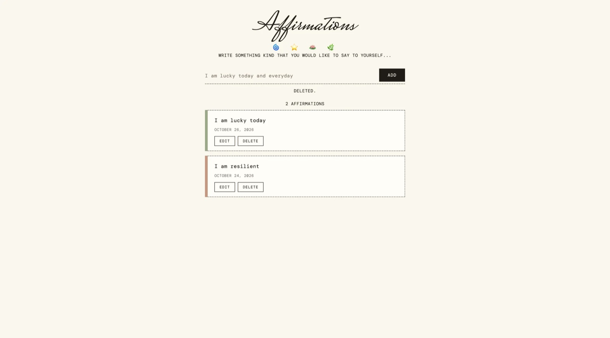

# Affirmations 🪷

A small app where you can write kind things to yourself, then save, change, or delete them.

## Description

This is a CRUD app I built to practice making my own API with Node, Express, and MongoDB. Each affirmation is one saved note with its text and the date it was made. The page talks to my API using `fetch`, so you can add a new affirmation, edit one, or delete one without the page reloading. I also tested the API by itself with Thunder Client before I built the page. There are no accounts, so it's meant to be run on my own computer.

## Screenshot



## Features

- Write a new affirmation and add it to the list
- See all your affirmations, newest first, with the date you made each one
- Edit an affirmation (it says "edited" after you change it)
- Delete an affirmation (it asks you to confirm first)
- Blank affirmations are not allowed, and you get a message telling you why
- Bad ids and ids that don't exist get a clear error from the API instead of crashing the server
- Custom API that can be used on its own, without the page

## Tech Used

- HTML
- CSS
- JavaScript
- Node.js
- Express
- MongoDB with Mongoose
- EJS
- dotenv

## How to Use

This app needs [Node.js](https://nodejs.org) and a MongoDB database (I used a free MongoDB Atlas cluster).

1. Download or clone the project, then open the folder in your terminal.
2. Install the packages:
   ```
   npm install
   ```
3. Make your own `.env` file by copying `.env.example`, then add your MongoDB connection string:
   ```
   MONGODB_URI=your MongoDB connection string
   ```
   The `.env` file is in `.gitignore` so my database password doesn't go on GitHub.
4. Start the server:
   ```
   npm start
   ```
5. Open your browser and go to `localhost:3000`.
6. Type an affirmation in the box and click **Add**.
7. Click **Edit** on a card to change it, then **Save**. Click **Delete** to remove one.
8. To stop the server, press Ctrl + C in the terminal.

**Using just the API:** you can also send requests with Thunder Client or Postman. For POST and PATCH, send JSON like `{ "text": "I am enough" }`.

## How It Works

1. When you submit the form, `main.js` sends your text to the server with `fetch`.
2. The server checks that the text isn't empty, then saves it in MongoDB with Mongoose. Mongoose adds the created and updated dates for me.
3. The server sends the saved affirmation back, and the page adds it to the top of the list.
4. Edit and Delete work the same way. They send the affirmation's id to the server, which updates or deletes it in MongoDB, and then the page shows the change.

The routes follow the CRUD pattern from class:

| Action | Method | Route | Success response |
|---|---|---|---|
| Create | POST | `/api/affirmations` | 201 with the new affirmation |
| Read all | GET | `/api/affirmations` | 200 with a list |
| Read one | GET | `/api/affirmations/:id` | 200 with the affirmation |
| Update | PATCH | `/api/affirmations/:id` | 200 with the updated affirmation |
| Delete | DELETE | `/api/affirmations/:id` | 200 with a success message |

Errors: 400 for empty text or a bad id, 404 when a valid id isn't in the database.

## What I Learned

- How to build all four CRUD actions on my own Express server
- How to connect to MongoDB with Mongoose and set rules for my data
- How to use environment variables so my database link stays out of GitHub
- Why I had to change my database password after it showed up in my code
- How to send the right status codes, like 201, 400, and 404
- How to test an API with Thunder Client before building the page
- How to connect an EJS page to my API with `fetch`

VIEW APP HERE: https://express-fri5.onrender.com

## Author

Maya Rose 🌹
